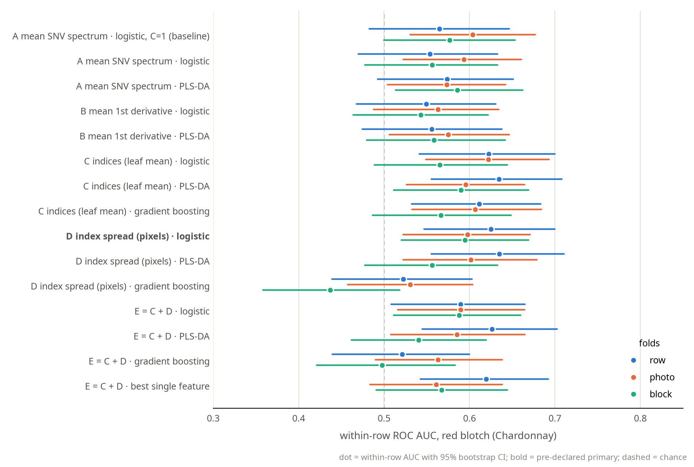
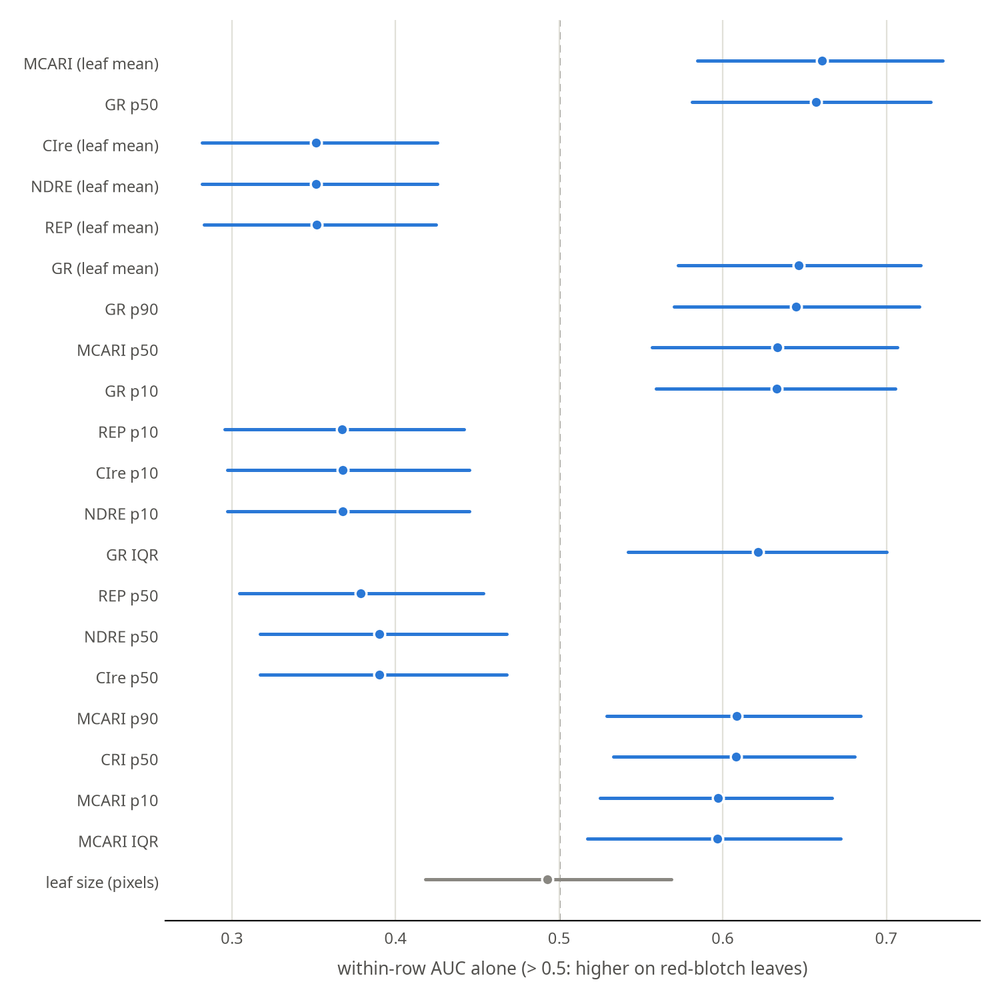

# Red blotch from leaf spectra, within Chardonnay: report

**Question.** Inside Chardonnay (250 leaves, 88 with red blotch), does any spectrum-based model detect red blotch
better than the plain baseline: logistic regression on the SNV leaf-mean spectrum?

> **Rerun 2026-10-29 with the camera's factory wavelengths.** The first run used a nominal 400–1000 nm grid
> (`vine_hsi.h5` was built from leaf headers that had lost the calibration), which placed every named index band
> 1–2 bands (up to ~5 nm) off. Feature sets C, D and E changed; A, B and the baseline did not. All numbers below
> are from the rerun; the previous outputs are in `CODE/header_backups/classification_before_rerun/`.

> **Rerun 2026-10-30 with folds built from the real camera images.** The first folds assumed 5 leaves per photo, but
> Chardonnay R1 has 12 images of 4 leaves and one of 2 (`../../clean/leaf_sources.csv`, matched by exact pixel values). That
> split 2 R1 photos under `block` and 4 under `photo`. No photo is split now.
> - `row`: unchanged.
> - `block`: 4 leaves moved fold (R1 V11, 12, 31, 32).
> - `photo`: a new random draw (206 of 250 leaves moved), so its changes can't be attributed to the fix alone.
>
> Previous outputs: `before_capture_folds/`.

**Short answer.** No. The plain mean spectrum already captures the signal, and no feature set or model reliably
adds to it.
- **Pre-declared test:** feature set D (index spread across the leaf) + logistic regression with `block` folds
  scored level with the baseline (0.595 vs 0.577, Δ +0.018 [−0.077, +0.113]). Against chance it just reaches
  permutation p = 0.048, but that result is fragile (see below).
- **Size of the signal:** within-row AUC is about 0.54–0.64 across linear pipelines and fold designs
  (gradient boosting on the pixel-spread features does worse).
- **Most consistent separators:** green/red reflectance and the red edge.

All 15 pipelines and every number: `results/metrics.md`. Set-up and the pre-declared plan: `README.md`.

## Checks
- **Same folds as the CNN.** The fold assignment is identical, leaf by leaf, to `clean/disease_classification/attention_mil` for
  `row`, `photo` and `block`. The baseline reproduces that folder's numbers: 0.565 / 0.604 / 0.577.
- **D is not measuring leaf size.** Leaf size alone scores a within-row AUC of 0.49–0.52 under every scheme.
- **Edges, glints and division blow-ups are excluded from D.** Its pixel statistics use only interior pixels
  (mask eroded by 2 px), drop glint pixels, and clamp reflectance before any index that divides by it.

## Pre-declared primary result (`block` folds)

| | within-row AUC [95% CI] | Δ vs baseline [95% CI] | permutation p (1000, whole pipeline rerun) |
|---|---|---|---|
| baseline: A mean SNV spectrum · logistic, C = 1 | 0.577 [0.500, 0.653] | — | 0.075 |
| **D index spread (pixels) · logistic** | **0.595 [0.520, 0.669]** | **+0.018 [−0.077, +0.113]** | **0.048** |

- **The hypothesis isn't supported.** Index patchiness doesn't add measurably to the leaf mean: Δ is +0.018, with
  an interval centred near 0.
- **p = 0.048 is not a robust finding.** With the earlier folds, the same test gave 0.558 and p = 0.157. Only 4 leaves
  changed fold, but the inner CV then picked C = 0.1 instead of 10 for one test fold, and that alone shifts the score.
  It also just clears the null's 95th percentile (0.592), and the baseline is at p = 0.075.
- **This is also the best linear pipeline here,** with a family-wise p of 0.244 once you account for it having
  been picked from 12.

## Every pipeline, three fold designs (exploratory)

| within-row AUC | `row` (unseen rows) | `photo` (random photos) | `block` (neighbour blocks) |
|---|---|---|---|
| baseline (A · logistic, C = 1) | 0.565 | 0.604 | 0.577 |
| A · logistic, C tuned / PLS-DA | 0.554 / 0.574 | 0.593 / 0.573 | 0.556 / 0.586 |
| B derivative · logistic / PLS-DA | 0.549 / 0.556 | 0.563 / 0.575 | 0.543 / 0.559 |
| C indices · logistic / PLS-DA | 0.622 / 0.634 | **0.622** / 0.596 | 0.565 / 0.590 |
| D index spread · logistic / PLS-DA | 0.625 / **0.635** | 0.598 / 0.602 | **0.595** / 0.556 |
| E = C + D · logistic / PLS-DA | 0.589 / 0.627 | 0.589 / 0.585 | 0.588 / 0.541 |
| gradient boosting (C / D / E) | 0.612 / 0.523 / 0.521 | 0.607 / 0.530 / 0.563 | 0.566 / 0.437 / 0.498 |
| best single feature (post hoc) | 0.620 | 0.561 | 0.568 |

1. **Indices only look better on unseen rows.**
   - Under `row` folds, the index sets (C, D, E with linear models) reach 0.589–0.635, against the baseline's 0.565.
   - That's Δ +0.02 to +0.07, with every interval including 0.
   - Under `photo` and `block` the same pipelines are level with the baseline (Δ −0.04 to +0.02).
   - The most likely reading: a few robust indices transfer between rows a little better than 204 correlated bands,
     but the gain is small and not established.
2. **More flexible models do worse on the pixel-spread features.**
   - Gradient boosting on D and E is the weakest everywhere: 0.44–0.56. On C (leaf-mean indices) it is level with
     the linear models (0.57–0.61).
   - One of its runs is significantly below the baseline: D under `block` (Δ −0.140 [−0.232, −0.045]).
   - With about 200 training leaves, flexibility buys overfitting, not signal.
3. **The inner CV usually picks the most constrained setting.**
   - Logistic regression on the indices takes C = 0.01, the strongest regularisation offered, in 14 of 15 folds
     (10 in the other).
   - PLS-DA on the indices takes 1 component in 13 of 15 folds (2 and 5 in the others).
   - The data support only a very simple score.
4. **The plain baseline is never beaten with confidence** under any design. The only significant difference is
   a loss (gradient boosting).

## Which features separate red blotch
Each feature on its own, with no model and no fitting, scored by within-row AUC:

- **Higher on red-blotch leaves:** the green/red ratio (R550/R670: leaf mean, median and 90th percentile, AUC ≈ 0.65),
  MCARI (0.66), and CRI (≈ 0.61).
- **Lower on red-blotch leaves:** the red-edge indices: red-edge position, NDRE and CI red-edge (AUC 0.35);
  also PRI (0.41–0.42).
- **Consistent with `../disease_differences/`,** whose one significant within-variety effect was Chardonnay healthy
  vs red blotch: red edge around 703 nm and green around 520–620 nm.
- **These single-feature numbers are optimistic,** because the best of 57 correlated features was picked after
  looking. Picked fairly, on the training folds only, the best single feature scores 0.56–0.62 on the test fold.

## Compared with the whole-leaf CNN (`../../clean/disease_classification/attention_mil/`)
Same leaves, same folds, same metric. The spectrum models train on 4 folds; the CNN trained on 3, keeping 1 for
early stopping.

| red blotch, within-row AUC | `row` | `photo` | `block` |
|---|---|---|---|
| CNN arms, no jitter (range of 4) | 0.49–0.64 | 0.59–0.62 | 0.54–0.57 |
| spectrum pipelines, linear (range of 11) | 0.55–0.64 | 0.56–0.62 | 0.54–0.60 |

Both families land in the same band. Neither the CNN's spatial view nor the index features get past about 0.64.

## For the poster
- **Claim:** "Within Chardonnay, red blotch is weakly detectable from leaf reflectance (within-row AUC ≈ 0.56–0.64).
  The signal sits in the red edge and the green/red balance. Neither vegetation indices, their spread across the
  leaf, nor a whole-leaf CNN improves on the leaf's mean spectrum."
- **Figures:**
  - `figures/feature_auc.png` shows *where* the signal is.
  - `figures/auc_by_pipeline.png` shows that no pipeline beats the baseline.
- **Not supported:** "index spread / patchiness helps" (the pre-declared test came out at Δ = +0.02 vs the baseline,
  and its p = 0.048 doesn't survive a small change in folds); "model X is best".

## If you continue
- **One pre-specified index.** Take the red-edge position or the green/red ratio of the leaf mean, fixed in advance
  with no selection, and validate it on new data. Here it scores about 0.65 within rows, but only after picking it
  from 57.
- **More leaves.** With 250 leaves, the 95% intervals are about ±0.08 wide: as wide as the differences between
  methods.
- **Cross-variety training.** Vidal (169 red blotch / 81 not) could add red-blotch examples, with each variety
  normalised and scoring still within Chardonnay. This is the one untested way to get more training data.
