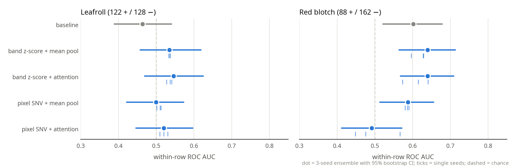
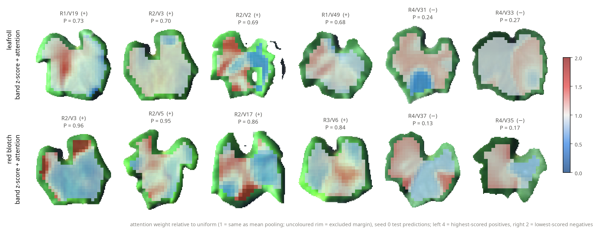

# Whole-leaf CNN with attention pooling on Chardonnay: report

**Question.** Within one variety (Chardonnay, 250 leaves), can a small CNN that sees the whole leaf
cube detect leafroll or red blotch better than a logistic regression on the leaf's mean spectrum?
And does attention pooling, which can let a few symptomatic patches decide a leaf, beat plain averaging?

**Design.** Each field row tests once, the next row is validation (early stopping), and the other 3 train.
The baseline trains on the same 3 rows, so neither model has more data.

**Short answer.** No reliable gain on either question.
- **Leafroll:** at or near chance (CNN within-row AUC 0.50–0.55, baseline 0.46).
- **Red blotch:** the best CNN reaches 0.64 against the baseline's 0.60, with overlapping intervals.
- **Why the red blotch number looks better than it is:** the margin comes almost entirely from one test row (R3).
- **Attention:** its weights are nearly uniform, so in practice it behaves like mean pooling.
- **Learning:** the network can memorise the training rows, but what it learns does not carry over to a held-out row.

Settings: no band or brightness jitter, dropout 0.5, 3 seeds.
Set-up details: `README.md`. Full tables: `results/row_no_brightness_jitter/metrics.md`.

## Checks before training
- **Padding cannot leak into a prediction.** Masked batch norm and masked pooling use leaf positions only.
  Shifting a leaf by 8 px or enlarging the canvas by 32 px changed its logit by at most 5 × 10⁻⁷. The background is
  exactly 0 after both preprocessings.
- **Photos never straddle train and test.** `../../leaf_sources.csv` matched every leaf to its camera image by exact
  pixel values: Chardonnay R1 has 12 images of 4 leaves and one of 2; R2–R5 have 5 per image. No row splits an image.
- **No capture-date confound.** All 250 Chardonnay leaves were imaged on the same day (2026-08-26).
- **Every row has positives for both diseases** (red blotch 10–26 per row, leafroll 10–33).

## Results
AUC compares leaves of the same row, so a row's disease rate can't help (0.5 = chance). Each value is the 3-seed
ensemble with a 95% bootstrap interval. Δ is the paired difference to the baseline.



| model | Red blotch AUC | Δ | Leafroll AUC | Δ |
|---|---|---|---|---|
| baseline | 0.602 [0.521, 0.679] | | 0.464 [0.389, 0.540] | |
| band z-score + mean pool | 0.640 [0.564, 0.713] | +0.038 [−0.045, +0.121] | 0.535 [0.458, 0.619] | +0.071 [−0.026, +0.168] |
| band z-score + attention | 0.640 [0.568, 0.709] | +0.038 [−0.045, +0.118] | 0.546 [0.469, 0.624] | +0.082 [−0.008, +0.177] |
| pixel SNV + mean pool | 0.588 [0.513, 0.656] | −0.014 [−0.095, +0.068] | 0.500 [0.422, 0.573] | +0.036 [−0.058, +0.128] |
| pixel SNV + attention | 0.491 [0.412, 0.572] | −0.110 [−0.196, −0.024] | 0.520 [0.446, 0.597] | +0.056 [−0.028, +0.141] |

## What the numbers say
1. **Red blotch: no CNN arm beats the baseline with confidence.** The closest are the band z-score arms, at Δ +0.038.
   On R3 they score 0.86–0.88 against the baseline's 0.64; on the other rows they score 0.52–0.64 against 0.53–0.67.
2. **SNV + attention is below the baseline on red blotch.** It is one of 8 task × arm results, and its seeds range
   from 0.45 to 0.57, so treat this as weak evidence.
3. **Small changes move results as much as the differences between arms.** Single seeds of one arm differ by up to 0.12.
4. **Leafroll stays at or near chance.** No interval on Δ excludes 0. Where the band z-score arms look ahead, it is
   mostly because the baseline is below chance, with 0.20 on R4.
5. **Attention behaves like mean pooling.**
   - **Concentration:** the effective number of positions a leaf's attention covers, 1 / Σ a², is a median 97–99% of
     its valid positions (seed 0).
   - **Heatmaps** (`figures/row_no_brightness_jitter/attention_maps.png`, fixed scale where 1 = uniform): no
     concentration on a few patches.
   - **Consequence:** the label-noise idea (let symptomatic patches decide) could not be tested. No weighting of
     patches carried over to a new row.



## Training diagnostics: underfitting or no transferable signal?
These checks were made on the first runs, which still used jitter. "No better than the baseline" could mean the network
could not learn at all. Two checks separate the two cases:
- **With regularisation** (augmentation, dropout 0.5, weight decay 0.01), training loss barely moves.
  - Leafroll: median 0.75 → 0.70 over the run. ln 2 ≈ 0.69 is a coin flip.
  - Red blotch: 0.93 → 0.84, against about 0.90 for a constant prediction.
- **Capacity test** (one fold, band z-score + attention, no augmentation, no dropout, no weight decay, 150 epochs).
  - The same network memorises the 150 training leaves: training loss 0.84 → 0.001 (leafroll) and 1.08 → 0.09
    (red blotch).
  - But the lowest validation loss comes at epochs 2–16. The more it fits the 3 training rows, the worse it does on
    a new row.

So the network can learn, and is not under-powered. Both are what we would see if, at this sample size, the leaf cubes
carry no disease pattern that holds across rows. A larger dataset, or a much better architecture, could still change
that; this run cannot rule it out.

## Earlier runs
Their files are deleted, along with the code for the 4-row baseline and the `photo` and `block` folds; only these numbers remain. None changed the conclusion.
- **Baseline on 4 rows:** red blotch 0.565 [0.482, 0.646], leafroll 0.460 [0.387, 0.538]. Measured against it, the best
  red blotch Δ was +0.074 [−0.007, +0.162]. The baseline scores higher on red blotch with fewer rows, so its row
  count is itself a source of noise.
- **Random photos in every fold (`photo`):** red blotch, baseline 0.604, CNN arms 0.587–0.620 (best Δ +0.016
  [−0.061, +0.091] against a 4-fold baseline). Leafroll, baseline 0.489, CNN arms 0.46–0.59.
- **Blocks of neighbouring vines in every fold (`block`):** red blotch, baseline 0.577, CNN arms 0.536–0.572 (best Δ −0.005
  [−0.101, +0.095] against a 4-fold baseline). Leafroll, baseline 0.433, CNN arms 0.46–0.53.
- **The best arm changed with the fold design:** SNV + attention was the worst under row folds and the best under `photo`.
- **With jitter (first runs):** red blotch, CNN arms 0.60–0.62 on row folds. Training also scaled each band by 2% and leaf
  brightness by U(0.8, 1.2).
- **Dropout 0.2:** no overall gain across all 24 results of the three designs (mean change −0.004; 9 up, 15 down).

## Context
This matches the archived transfer-learning study (`claude runs/cache/transfer_learning_study`). There,
within-variety AUC stayed at 0.48–0.59 for every approach, including attention MIL over pixel bags and a whole-leaf
ResNet-18. This run differs in three ways:
- one variety, binary tasks;
- native-resolution whole leaves with masked normalisation;
- attention over regions of about 26 px, not single pixels.

None of these changed the picture.

## For the poster
- **Claim:** "A whole-leaf hyperspectral CNN, trained within Chardonnay, does not reliably detect leafroll or red
  blotch better than the leaf's mean spectrum on field rows it has never seen (best red-blotch CNN 0.64 within rows,
  against 0.60 for the baseline, with overlapping intervals)."
- **Figures:**
  - `figures/row_no_brightness_jitter/auc_comparison.png` shows the main result.
  - `figures/row_no_brightness_jitter/attention_maps.png` is a fair illustration only with its caption: the weights
    are nearly uniform.
- **Not supported:** "attention finds symptoms"; "spatial information helps".
- **Caveat to state:** the network can memorise the training leaves, but what it learns does not carry over to
  leaves from other rows. With about 150 training leaves per fold, the result is "no transferable signal at this
  sample size", not proof that no signal exists.

## If you continue
- **Red blotch only.** Leafroll showed no signal. The next step is to strengthen the mean-spectrum signal, not the CNN.
- **Row R3 for red blotch.** Look at those 13 positives and what makes them easy: visible symptoms, or something
  about that row. That is the one place a signal shows up.
- **Label noise.** If many infected leaves have no symptoms, no model can reach high AUC on these labels.
  Visual symptom scores, if any exist, would be a cleaner target.
- **More leaves per variety.** That would do more than any architecture change: the 95% intervals are about ±0.08 wide.

## Reproducing
```bash
cd clean/disease_classification/attention_mil
../../../.venv/bin/python -u run_experiments.py --no-brightness-jitter   # ~6 min on the RTX PRO 5000
../../../.venv/bin/python -u report.py --no-brightness-jitter
```
Seeds are fixed, but cuDNN max-pool backward has no deterministic kernel, so reruns can differ slightly
(`torch.use_deterministic_algorithms(..., warn_only=True)`).
