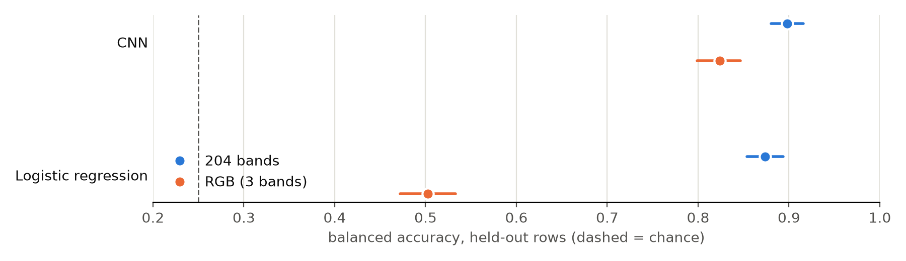

# Variety classification: report

**Question.** How well can a leaf's variety be predicted from held-out field rows, does a whole-leaf CNN beat logistic regression on the mean spectrum, and do 204 bands beat RGB? Every model here uses SNV, which removes brightness.

**Design.** Every model uses the same split. One field row tests, the next is validation, and the other 3 train. The validation row picks the CNN's checkpoint and logistic regression's C, and it never fits either model. This was fixed before these logistic-regression scores were seen.

**Short answer.**
- **CNN vs logistic regression on 204 bands:** nearly level. A single CNN averages 0.875, against 0.874 for logistic regression. Only the 3-seed ensemble is ahead, at 0.898 (Δ +0.024 [+0.007, +0.041]).
- **CNN vs logistic regression on RGB:** the CNN is far ahead, 0.824 against 0.503 (Δ +0.321 [+0.286, +0.355]).
- **204 bands vs RGB:** 204 bands win in both models. CNN ensemble Δ +0.074 [+0.049, +0.100]; logistic regression Δ +0.371 [+0.341, +0.404].

## Results

Balanced accuracy (chance 0.25), with 95% intervals from resampling leaves. CNN numbers are 3-seed ensembles.

| model | 204 bands | RGB | Δ 204 bands − RGB [95% CI] |
|---|---|---|---|
| CNN | 0.898 (0.880–0.916) | 0.824 (0.799–0.846) | +0.074 [+0.049, +0.100] |
| Logistic regression | 0.874 (0.853–0.894) | 0.503 (0.472–0.533) | +0.371 [+0.341, +0.404] |

By held-out row:

| model | R1 | R2 | R3 | R4 | R5 | mean without R1 |
|---|---|---|---|---|---|---|
| CNN, 204 bands | 0.595 | 0.975 | 0.975 | 0.975 | 0.970 | 0.974 |
| Logistic regression, 204 bands | 0.615 | 0.975 | 0.970 | 0.925 | 0.885 | 0.939 |
| CNN, RGB | 0.730 | 0.870 | 0.905 | 0.820 | 0.795 | 0.848 |
| Logistic regression, RGB | 0.420 | 0.500 | 0.599 | 0.520 | 0.475 | 0.524 |

## What the numbers say

1. **Test row R1 pulls the 204-band scores down.** Both models fall to about 0.6 there, and score 0.885–0.975 on the other rows. It is the only test row that trains on neither R1 nor R2, because R2 is its validation row. Earlier runs with R2 in training reached 0.905 (logistic regression) and 0.915 (CNN) on R1. Why these two rows are alike wasn't investigated.
2. **The ensemble's lead over logistic regression comes from averaging seeds.** The 204-band seeds score 0.857, 0.856 and 0.914, so a single CNN isn't reliably ahead of logistic regression. On RGB, all three seeds (0.780, 0.791, 0.788) are far above logistic regression.
3. **The RGB gap is partly caused by SNV.** With 3 values, SNV leaves very little: two of the three degrees of freedom go to its centring and scaling. The earlier raw-reflectance run in `claude runs/variety_logistic_regression_rgb` reached 0.859 with RGB, so 0.503 isn't what RGB can do in general.
4. **The CNN on RGB probably isn't using colour alone.** The extra 0.321 must come from spatial information: pattern within the leaf, or leaf size and shape. Leaf size alone (pixel count, height, width) scores 0.642 in logistic regression. No test here separates these.
5. **Intervals are narrower than the real uncertainty.** They resample leaves, but leaves in a row aren't independent, there are only 5 rows, and they ignore seed choice.

## Caveat: variety is confounded with imaging day

Baco was imaged on 2026-08-12, Chardonnay on 2026-08-26, and Cab Franc and Vidal on 2026-09-03. SNV removes brightness, but not any spectral difference between sessions, such as lighting colour. These scores show that the varieties can be told apart in this dataset, not that the cause is cultivar biology alone. Rows are held out, but no imaging day is, since each variety has only one.

## Earlier runs

Their code and files are deleted; only these numbers remain. They used other training designs, so they don't compare directly with the results above.

| model | 204 bands | RGB |
|---|---|---|
| Logistic regression, 4 training rows, C chosen inside them | 0.939 | 0.500 |
| Logistic regression, 3 training rows, C chosen inside them | 0.849 | 0.488 |
| CNN ensemble, 4 training rows, 37 epochs, no validation | 0.949 | 0.838 |
| CNN ensemble, 4 training rows, epochs chosen inside each split | 0.925 | 0.876 |
| CNN single-model mean, 4 training rows, epochs chosen inside each split | 0.814 | 0.872 |

- **On 204 bands, giving up a training row costs logistic regression about 0.07–0.09.** That is the price of the design above, which matches the CNN's data. RGB barely changes.
- **Without validation, the CNN's ranking depended on the epoch count.** At 37 epochs each, 204 bands won by +0.111. At 8 each, RGB won (0.685 vs 0.791). The 37-epoch count was picked after seeing test rows, so 0.949 is optimistic.
- **Adding the mean spectrum to the CNN's last layer did not help.** Ensemble change +0.000 [−0.016, +0.016] on 204 bands and +0.009 [−0.005, +0.025] on RGB.

## For the poster

- **Claim:** "On held-out rows, with 3 rows for training and one for validation, a leaf's SNV mean spectrum predicts its variety with balanced accuracy 0.87 (chance 0.25). RGB alone reaches 0.50 under the same model. A small whole-leaf CNN reaches 0.90 and 0.82 as a 3-seed ensemble."
- **State alongside it:** the imaging-day caveat, that the RGB figure is for SNV-normalised RGB, and that a single 204-band CNN (0.875) is level with logistic regression.
- **Not supported:** "a CNN reliably beats logistic regression on 204 bands", "adding the mean spectrum improves the CNN", and "hyperspectral beats RGB by 0.37 in general".
