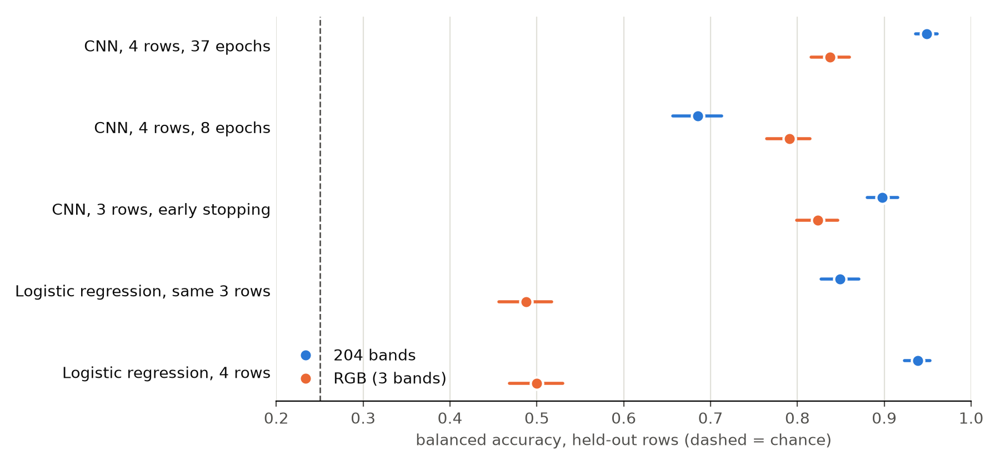

# Variety classification: report

**Question.** How well can a leaf's variety be predicted from held-out field rows, does a whole-leaf CNN beat logistic regression on the mean spectrum, and do 204 bands beat RGB? Every model here uses SNV, which removes brightness.

**Short answer.**
- **Most dependable model:** logistic regression on all 204 bands, trained on 4 rows: balanced accuracy 0.939 (chance 0.25). It has no epoch count to choose and gives the same answer every time.
- **CNN vs logistic regression:** no gain shown. With all 4 rows and 37 epochs the CNN reaches 0.949, level with logistic regression (Δ +0.010 [−0.005, +0.026]), but that number depends heavily on the number of epochs.
- **204 bands vs RGB:** 204 bands win by a wide margin in logistic regression. In the CNN they win when trained properly, but not at 8 epochs, where the network has not finished learning.

## Results

Balanced accuracy, with 95% intervals from resampling leaves. CNN numbers are 3-seed ensembles.

| model | 204 bands | RGB | Δ 204 bands − RGB [95% CI] |
|---|---|---|---|
| CNN, 4 rows, no validation, 37 epochs | 0.949 (0.936–0.961) | 0.838 (0.816–0.860) | +0.111 [+0.088, +0.134] |
| CNN, 4 rows, no validation, 8 epochs | 0.685 (0.656–0.713) | 0.791 (0.765–0.814) | −0.105 [−0.141, −0.070] |
| CNN, 3 rows, early stopping on a fourth | 0.898 (0.880–0.916) | 0.824 (0.799–0.846) | +0.074 [+0.049, +0.100] |
| Logistic regression, same 3 rows | 0.849 (0.827–0.871) | 0.488 (0.457–0.517) | +0.361 [+0.328, +0.394] |
| Logistic regression, 4 rows | 0.939 (0.924–0.952) | 0.500 (0.468–0.530) | +0.439 [+0.408, +0.470] |

By held-out row:

| model | R1 | R2 | R3 | R4 | R5 | mean without R1 |
|---|---|---|---|---|---|---|
| CNN, 204 bands, 4 rows, 37 epochs | 0.915 | 0.970 | 0.964 | 0.960 | 0.935 | 0.957 |
| CNN, 204 bands, 3 rows, early stopping | 0.595 | 0.975 | 0.975 | 0.975 | 0.970 | 0.974 |
| CNN, RGB, 4 rows, 37 epochs | 0.880 | 0.875 | 0.855 | 0.825 | 0.755 | 0.828 |
| CNN, RGB, 3 rows, early stopping | 0.730 | 0.870 | 0.905 | 0.820 | 0.795 | 0.848 |
| Logistic regression, 204 bands, same 3 rows | 0.610 | 0.890 | 0.970 | 0.935 | 0.840 | 0.909 |
| Logistic regression, 204 bands, 4 rows | 0.905 | 0.960 | 0.990 | 0.960 | 0.880 | 0.948 |

## What the numbers say

1. **The no-validation CNN depends on the number of epochs, and the chosen count failed.** The counts were fixed in advance at 8 (204 bands) and 37 (RGB), each 3/4 of the earlier median best epoch. On that pre-chosen pair RGB beats 204 bands (Δ −0.153 [−0.188, −0.118]), but only because 8 epochs is too few: training loss is still 0.32 there and reaches 0.12 by epoch 37.
   - The sensitivity runs flip the answer. At 37 epochs each, 204 bands win by +0.111.
   - The likely reason for the failed choice: early stopping keeps the best checkpoint from noisy epochs, so its median is not a good place to stop and keep the last weights.
   - The 37-epoch 204-band run wasn't chosen in advance, and the choice between 8 and 37 here was seen on test rows, so 0.949 is optimistic. A clean number needs the count chosen inside each training split.
2. **The ensemble hides large seed noise.** At 37 epochs and 204 bands, single seeds score 0.826, 0.932 and 0.744, while their ensemble scores 0.949. The early-stopping seeds were 0.857, 0.856 and 0.914. One trained CNN is much less dependable than the ensemble number suggests.
3. **Rows R1 and R2 need each other in training.** Training on all 4 rows supports this: the 204-band CNN on R1 goes from 0.595 to 0.915. The CNN's validation row costs it training data, and with early stopping, test row R1 is the only fold that trains on neither R1 nor R2.
   - Logistic regression trained on R3, R4 and R5 scores 0.61 on R1 and 0.655 on R2.
   - Adding the other of the two raises that to 0.905 on R1 and 0.96 on R2.
   - This explains both the CNN's 0.595 on R1 and most of logistic regression's fall from 0.939 to 0.849. Why these two rows are alike wasn't investigated.
4. **The RGB gap is partly caused by SNV.** With 3 values, SNV leaves very little: two of the three degrees of freedom go to its centring and scaling. The earlier raw-reflectance run in `claude runs/variety_logistic_regression_rgb` reached 0.859 with RGB, so 0.500 isn't what RGB can do in general.
5. **The CNN on RGB probably isn't using colour alone.** It reaches 0.79–0.84 while logistic regression on the same 3 bands reaches 0.49–0.50, so the extra must come from spatial information: pattern within the leaf, or leaf size and shape. Leaf size alone (pixel count, height, width) scores 0.654 in logistic regression. No test here separates these.
6. **Intervals are narrower than the real uncertainty.** They resample leaves, but leaves in a row aren't independent, there are only 5 rows, and they ignore seed and epoch choice. Points 1–3 show how much those matter.

## Which wavelengths matter (logistic regression, 204 bands)

`logistic_regression/results/band_importance.md`, `logistic_regression/figures/band_importance.png`:

- **No single band is enough:** the best one, 691 nm, scores 0.71.
- **Any region alone falls short of all 204 bands (0.939):** red 0.889, green 0.882, red edge 0.864, NIR 0.803, blue 0.766.
- **Choosing bands from the training rows:** 50 bands reach 0.895, 10 reach 0.797.

## Caveat: variety is confounded with imaging day

Baco was imaged on 2026-08-12, Chardonnay on 2026-08-26, and Cab Franc and Vidal on 2026-09-03. SNV removes brightness, but not any spectral difference between sessions, such as lighting colour. These scores show that the varieties can be told apart in this dataset, not that the cause is cultivar biology alone. Rows are held out, but no imaging day is, since each variety has only one.

## For the poster

- **Claim:** "On held-out rows, a leaf's SNV mean spectrum predicts its variety with balanced accuracy 0.94 (chance 0.25). RGB alone reaches 0.50 under the same model."
- **State alongside it:** the imaging-day caveat, and that the RGB figure is for SNV-normalised RGB.
- **Not supported:** "the CNN beats logistic regression", "skipping validation improves the CNN", and "hyperspectral beats RGB by 0.44 in general".
